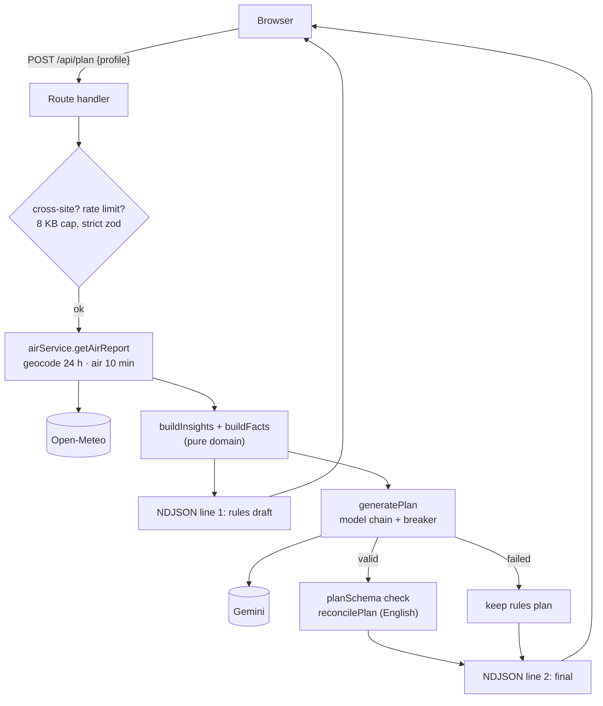

# Smog Shield

[](https://github.com/Sarcastic-Soul/smog-shield/actions/workflows/ci.yml)

**Live:** https://smog-shield.vercel.app · **Challenge 6:** Urban Air Quality Assistant

Smog Shield turns live air-quality data into a 24-hour plan for one family. You enter your city and who lives at home (children, older adults, asthma, a petrol-car commute, an LPG stove). It reads the current AQI and the hourly forecast, finds the cleanest and dirtiest hours, and works out what each choice means in numbers. Then Gemini writes a plan in plain words, in one of five languages, with the measured effect next to each step: "move the 45-minute walk to 12:00-14:00 and breathe 62% less PM2.5", "if 40 homes in your building took the bus, that is 27.6 t of CO₂ a year". A deterministic rule engine computes every number and also writes a full plan on its own. The rules plan shows in about a second and stays as the answer if Gemini is slow or down.

## Highlights

| Criterion             | What we did                                                                                                                                                                                                                                                                                                                                  | Evidence                                                                                                                                                                                                                                                                                        |
| --------------------- | -------------------------------------------------------------------------------------------------------------------------------------------------------------------------------------------------------------------------------------------------------------------------------------------------------------------------------------------- | ----------------------------------------------------------------------------------------------------------------------------------------------------------------------------------------------------------------------------------------------------------------------------------------------- |
| **Problem alignment** | Live AQI, main pollutant, 24-hour forecast and 3-day outlook; household risk with sensitive groups; clean/dirty 2-hour windows; low-exposure routine; indoor fixes; commute swaps with CO₂ and PM2.5 saved; actions with the building, school or workplace; safety alerts (CO from coal or wood fires, NO₂ from gas heaters); five languages | [`src/lib/domain/insights.ts`](src/lib/domain/insights.ts), [`src/lib/domain/windows.ts`](src/lib/domain/windows.ts), [`src/lib/domain/emissions.ts`](src/lib/domain/emissions.ts), [`src/lib/domain/exposure.ts`](src/lib/domain/exposure.ts), [`src/lib/domain/rules/`](src/lib/domain/rules) |
| **Code quality**      | Layered design (air, domain, ai, server, routes, components) with a pure domain; one zod `planSchema` as the contract for Gemini, the rules plan and the UI; factories with injected dependencies; one wiring file; strict TypeScript, ESLint, Prettier                                                                                      | [docs/ARCHITECTURE.md](docs/ARCHITECTURE.md), [docs/DECISIONS.md](docs/DECISIONS.md), [`src/lib/domain/plan.ts`](src/lib/domain/plan.ts), [`src/lib/server/services.ts`](src/lib/server/services.ts)                                                                                            |
| **Security**          | Per-request nonce CSP with `'strict-dynamic'`; 8 KB streamed body cap; strict zod schemas; cross-site refusal; per-IP rate limits; prompt-injection cleaning and fencing; facts rebuilt on the server; schema-checked model output; `server-only` key                                                                                        | [SECURITY.md](SECURITY.md), [`src/proxy.ts`](src/proxy.ts), [`src/lib/server/http.ts`](src/lib/server/http.ts), [`src/lib/ai/sanitize.ts`](src/lib/ai/sanitize.ts)                                                                                                                              |
| **Efficiency**        | Rules draft streamed in about a second; promise caches that share in-flight calls (geocode 24 h, air 10 min, plans 1 h); model chain plus circuit breaker; O(n) window search; zod lazy-loaded on the client; functions in `bom1` near users                                                                                                 | [`src/lib/server/ttl-cache.ts`](src/lib/server/ttl-cache.ts), [`src/lib/server/plan-service.ts`](src/lib/server/plan-service.ts), [`src/lib/ai/model-chain.ts`](src/lib/ai/model-chain.ts), [`src/lib/client/profile-storage.ts`](src/lib/client/profile-storage.ts)                            |
| **Testing**           | 641 Vitest tests in 51 files (about 99% coverage) plus 31 Playwright tests; `tests/unit` mirrors `src`; fakes passed through factories; Playwright e2e with the API mocked in the browser, axe scans and a real-browser CSP check; coverage thresholds enforced                                                                              | [docs/TESTING.md](docs/TESTING.md), [`vitest.config.mts`](vitest.config.mts), [`tests/e2e/`](tests/e2e)                                                                                                                                                                                         |
| **Accessibility**     | Skip link, landmarks, one `h1`, labelled fieldsets, 44 px targets, live regions, focus moved to results, screen-reader table for the chart, `lang` and `dir="rtl"` on generated text, reduced motion, light and dark themes; axe (WCAG 2.1 AA tags) on three states                                                                          | [`src/components/`](src/components), [`src/app/layout.tsx`](src/app/layout.tsx), [`tests/e2e/a11y.spec.ts`](tests/e2e/a11y.spec.ts)                                                                                                                                                             |

## What it does

1. **Live readings.** The server geocodes the city and pulls the current US AQI and the pollutant driving it (PM2.5, PM10, NO₂, ozone, CO, SO₂), the next 24 hours of hourly PM2.5 and AQI, and a 3-day outlook from [Open-Meteo](https://open-meteo.com/en/docs/air-quality-api) (CAMS data, no key needed).
2. **Household context.** Adults, children, people over 65, health conditions (asthma, COPD, heart disease, pregnancy, allergies), commute mode, distance and days, cooking fuel, heating, purifier, indoor smoking, waste burning nearby, daily outdoor minutes, budget, language and a free-text note ("my son has cricket at 5pm").
3. **Rule engine (deterministic, tested).** [`src/lib/domain`](src/lib/domain) turns readings and profile into facts:
   - household risk (sensitive members push risk up one band, as the EPA scale does) and whether an N95 is advised,
   - cleanest and worst 2-hour daytime windows, ranked by hourly PM2.5, labelled today or tomorrow,
   - inhaled dose for moving exercise to a cleaner hour or indoors (`concentration × breathing rate × time`),
   - indoor PM2.5 with windows shut, with a HEPA purifier, and with indoor smoking,
   - commute swaps with weekly and yearly CO₂ and tailpipe PM2.5 saved, scaled to 40 or 1,000 homes,
   - 3-day trend (worsening, steady, improving; a change over 15% counts),
   - safety alerts: carbon monoxide from coal or wood fires, NO₂ from unflued gas heaters, smoking near sensitive people.
4. **Gemini writes the plan.** The facts go to Gemini (`gemini-3.5-flash-lite`, with `gemini-3.1-flash-lite` and `gemini-3-flash-preview` as backups) with structured JSON output against the zod plan schema. The system prompt makes it quote only the given numbers, start from the local time now, fit the family's own plans into cleaner hours, name each at-risk group, suit the budget and write in the chosen language (English, Hindi, Urdu, Bengali or Punjabi). Details: [docs/PROMPTS.md](docs/PROMPTS.md).
5. **Instant draft, then Gemini.** The plan streams as NDJSON: a rules draft arrives first, and Gemini's tailored plan replaces it when ready, so nobody stares at a spinner.
6. **Rules check the AI.** English Gemini plans are topped up from the rule engine if they come back thin (fewer than 3 indoor fixes or 2 community actions, or one of the top 3 commute swaps missing). If Gemini is down, slow or returns invalid output, the full rules plan is used, and the page says so.
7. **Try a change, see the effect.** A client-side simulator lets the family switch commute modes, scale the change to their building or ward, toggle a purifier, and move their exercise to a cleaner hour or indoors. Numbers update at once with no extra requests.
8. **Ask follow-up questions.** A streamed Q&A box answers questions like "Is it safe for my kids to play outside after school?" from the same server-built facts.

## How it works



`/api/ask` follows the same checks, rebuilds the facts on the server, and streams Gemini's answer as `text/plain`. Full request lifecycles, the caching table and every fallback are in [docs/ARCHITECTURE.md](docs/ARCHITECTURE.md).

## Project structure

```text
src/
├── proxy.ts                  # fresh CSP nonce per page request
├── app/
│   ├── layout.tsx            # fonts, skip link, theme colours
│   ├── page.tsx              # per-request render (needed for the nonce)
│   ├── globals.css           # tokens, AQI band colours, reduced motion, dark mode
│   └── api/
│       ├── plan/route.ts     # NDJSON: rules draft, then final plan
│       └── ask/route.ts      # streamed plain-text answer
├── components/
│   ├── SmogShieldApp.tsx     # state, submit, focus, live status
│   ├── ProfileForm.tsx       # + form/{fields,HouseholdFields,LifestyleFields}.tsx
│   ├── AirReportPanel.tsx    # AQI now, main pollutant, risk
│   ├── ForecastStrip.tsx     # 24 h bars + screen-reader table, 3-day outlook
│   ├── PlanView.tsx          # routine, indoor fixes, swaps, community, groups
│   ├── ImpactSimulator.tsx   # what-if maths on the client
│   ├── AskPanel.tsx          # streamed follow-up questions
│   ├── ResultStates.tsx      # empty and loading states
│   └── ui.tsx                # small shared pieces (AQI band dot, …)
└── lib/
    ├── math.ts               # roundTo, mean
    ├── air/                  # Open-Meteo, server side
    │   ├── fetch-json.ts     # timeout, one retry, AirDataError
    │   ├── geocode.ts        # city -> coordinates (zod-checked)
    │   ├── open-meteo.ts     # current, hourly, outlook (zod-checked)
    │   ├── aqi.ts            # AQI bands, EPA 2024 PM2.5 -> AQI
    │   └── types.ts          # AirReport, local-time helpers
    ├── domain/               # pure: no I/O
    │   ├── profile.ts        # strict zod profile schema
    │   ├── profile-options.ts# labels, limits, defaults (no zod)
    │   ├── risk.ts           # household risk, sensitive groups, N95
    │   ├── windows.ts        # O(n) clean/dirty window search
    │   ├── exposure.ts       # dose, indoor PM2.5, purifier, N95, cooking
    │   ├── emissions.ts      # commute CO₂ / PM2.5, swaps, community scale
    │   ├── insights.ts       # every number the app shows
    │   ├── plan.ts           # planSchema + JSON schema for Gemini
    │   ├── result.ts         # PlanResult, PlanEvent
    │   ├── fallback-plan.ts  # full rules plan
    │   └── rules/            # community, groups, indoor, routine, swaps, text, reconcile
    ├── ai/                   # server side
    │   ├── facts.ts          # FACTS block
    │   ├── instructions.ts   # system instructions
    │   ├── prompt.ts         # fenced user prompts
    │   ├── sanitize.ts       # injection-safe user text
    │   ├── model-chain.ts    # try models in order on overload
    │   ├── circuit-breaker.ts# skip Gemini after repeated failures
    │   ├── budgets.ts        # time budgets per call and attempt
    │   └── gemini.ts         # server-only Gemini client
    ├── server/               # server side
    │   ├── services.ts       # the one wiring point (server-only)
    │   ├── plan-service.ts   # facts, draft/final events, plan caches
    │   ├── air-service.ts    # cached geocode + air report
    │   ├── ttl-cache.ts      # promise cache with expiry
    │   ├── lru.ts            # bounded LRU map
    │   ├── rate-limit.ts     # fixed-window per-IP limiter
    │   ├── http.ts           # readJson, byte cap, cross-site check, errors
    │   └── csp.ts            # page and API CSP strings
    └── client/               # browser side
        ├── api.ts            # requestPlan (NDJSON), askQuestion (stream)
        ├── errors.ts         # abort and message helpers
        └── profile-storage.ts# saved profile, lazy zod
```

Tests in [`tests/unit`](tests/unit) mirror this tree. More docs:

| Doc                                          | What it covers                                                           |
| -------------------------------------------- | ------------------------------------------------------------------------ |
| [docs/ARCHITECTURE.md](docs/ARCHITECTURE.md) | Layers, dependency rules, request lifecycles, caching, failure modes     |
| [docs/DECISIONS.md](docs/DECISIONS.md)       | Eight design decisions with context and trade-offs                       |
| [docs/PROMPTS.md](docs/PROMPTS.md)           | FACTS block, system rules, structured output, validation, reconciliation |
| [docs/TESTING.md](docs/TESTING.md)           | Test strategy, layout, fakes and mocks, e2e, coverage                    |
| [SECURITY.md](SECURITY.md)                   | Threat model and how to report a problem                                 |
| [CONTRIBUTING.md](CONTRIBUTING.md)           | Setup, scripts, code style, project rules, PR checklist                  |

## Security

- The Gemini key lives only on the server (`import "server-only"` in [`gemini.ts`](src/lib/ai/gemini.ts) and [`services.ts`](src/lib/server/services.ts)). The browser talks only to this app.
- Page CSP uses a fresh nonce per request with `'strict-dynamic'`, so no injected inline script can run. API responses get `default-src 'none'`. Also HSTS, `X-Frame-Options: DENY`, `nosniff`, strict referrer and permissions policies ([`next.config.ts`](next.config.ts)).
- Request bodies are capped by declared size and by a streaming byte counter that stops reading past 8 KB, then validated with strict zod schemas (unknown top-level keys rejected, numbers bounded, city limited to Latin letters).
- Cross-site browser calls to the API are refused, so other pages cannot spend the AI quota.
- User free text is NFKC-normalised, stripped of invisible control and format characters, `<` `>` and fake section labels, then wrapped in tags the system prompt marks as data. Model output is schema-checked before use. `/api/ask` rebuilds facts on the server, so a client cannot feed fake numbers to the model, and the assistant declines off-topic requests.
- Per-IP rate limits (10 plans a minute, 20 questions a minute, keyed on Vercel's `x-real-ip`), upstream timeouts, generic error messages.

Full threat model: [SECURITY.md](SECURITY.md).

## Efficiency

- Geocoding is cached for a day (unknown cities too), air data for 10 minutes keyed by rounded coordinates, and concurrent requests for the same key share one upstream call ([`ttl-cache.ts`](src/lib/server/ttl-cache.ts)).
- Gemini plans are cached for an hour per reading time and profile. After a failure, the rules plan is reused for a minute, and the circuit breaker skips Gemini for 60 s after 3 failures in a row, so users never wait on a model that is down.
- Each model attempt has a 15 s limit inside a 26 s plan budget ([`budgets.ts`](src/lib/ai/budgets.ts)); follow-up answers stream so text shows at once.
- The first useful plan arrives as a streamed rules draft; functions run in Mumbai (`bom1`) near the main users.
- The simulator uses domain helpers on numbers already sent. No animation library, and zod is lazy-loaded on the client so it is not in the first page load.
- Window search is a single O(n) sliding sum.

## Accessibility

- Semantic landmarks, skip link, one `h1`, labelled fields and fieldsets, 44 px touch targets, visible focus rings.
- Status changes are announced through a `role="status"` region and `aria-live` regions; focus moves to the results; errors use `role="alert"`.
- The forecast chart has a screen-reader table with exact values. Colour is never the only signal.
- Plans and answers can be read in five languages, with `lang` and `dir="rtl"` set for Urdu.
- Respects `prefers-reduced-motion` and `prefers-color-scheme` (light and dark). Works at 390 px with no sideways scroll.
- Checked with axe in the Playwright suite (empty, results and error states).

## Testing

641 Vitest tests in 51 files (99.2% statements, 97.3% branches covered), plus 31 Playwright tests. None of them needs an API key or network access.

- **Unit and component (Vitest + Testing Library):** air client, AQI maths, risk, windows, exposure and emissions, insights, plan schema, every rules section and reconciliation, FACTS and prompts, sanitizer, model chain, circuit breaker, Gemini client, caches, rate limiter, HTTP helpers, CSP, both route handlers, plan and air services, client helpers, and every component.
- **End-to-end (Playwright):** full plan flow, simulator, ask panel, error states, saved profile, keyboard-only use, 390 px layout, CSP nonce in a real browser, and axe scans of the empty, results and error states. The API is mocked in the browser, so no key or network is needed.
- **Coverage thresholds** (lines 85%, statements 85%, functions 80%, branches 75%) are enforced in [`vitest.config.mts`](vitest.config.mts).

Details: [docs/TESTING.md](docs/TESTING.md).

## Running it

```bash
pnpm install
cp .env.example .env.local   # add GEMINI_API_KEY
pnpm dev                      # http://localhost:3000

pnpm test            # unit + component tests
pnpm test:coverage   # with coverage thresholds
pnpm test:e2e        # end-to-end + axe (no key needed)
pnpm lint && pnpm typecheck && pnpm build
```

| Variable         | Required                 | Notes                                            |
| ---------------- | ------------------------ | ------------------------------------------------ |
| `GEMINI_API_KEY` | No (falls back to rules) | Google AI Studio key                             |
| `GEMINI_MODEL`   | No                       | Tried first; defaults to `gemini-3.5-flash-lite` |

## Assumptions

- **AQI scale.** Open-Meteo returns the US EPA AQI, so the app uses it everywhere. India's NAQI uses different breakpoints; PM2.5 in µg/m³ is shown next to it so either reading makes sense. Hourly bars and windows use the EPA 2024 PM2.5 breakpoints on hourly PM2.5, because the official AQI is a 24-hour average and hides the hour-to-hour swings that matter for planning.
- **City names** must be in English (Latin) letters; the Open-Meteo geocoder does not match Devanagari or Urdu script. The plan itself can be in five languages; page headings stay in English.
- **Emission and exposure factors** are published averages, used to show the size of a choice, not to audit anyone:
  - CO₂ per passenger-km: petrol car 0.14, diesel 0.15, CNG 0.11, two-wheeler 0.04, auto 0.06, bus 0.015, metro 0.02 kg (India GHG Program / ICCT ranges).
  - Indoor/outdoor PM2.5 ratio in closed winter homes: 0.7 (Delhi studies report 0.5 to 0.9). Indoor smoking adds about 40 µg/m³.
  - HEPA purifier sized for the room: about 60% less indoor PM2.5. Fitted N95 in real use: about 80% less inhaled PM2.5.
  - Breathing rate: 0.5 m³/h at rest, 1.6 m³/h exercising, light walking about twice resting (US EPA Exposure Factors Handbook).
  - 22 µg/m³ of PM2.5 for a day ≈ one cigarette (Berkeley Earth). WHO 24-hour PM2.5 guideline: 15 µg/m³.
  - Kitchen PM2.5 added while cooking: biomass ~500, kerosene ~150, LPG/PNG ~25, induction ~5 µg/m³ (WHO household air pollution ranges).
  - A mature tree takes up about 21 kg CO₂ a year.
- A commute is a return trip on each listed day; a year has 46 working weeks. Walking is offered only for trips up to 2.5 km and cycling up to 8 km. A "building" is 40 homes and a "ward" 1,000.
- Daytime planning hours are 06:00 to 21:00 local time.
- Rate limits and caches are in memory per server instance, which is enough for a demo; a shared store (e.g. Redis) would be used at scale ([docs/DECISIONS.md #8](docs/DECISIONS.md#8-in-memory-caches-and-rate-limits)).
- Advice is general public-health guidance, not medical advice.
