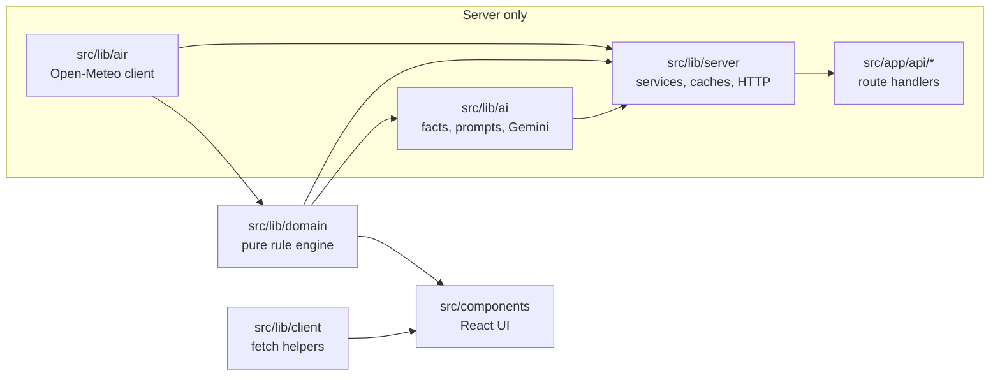
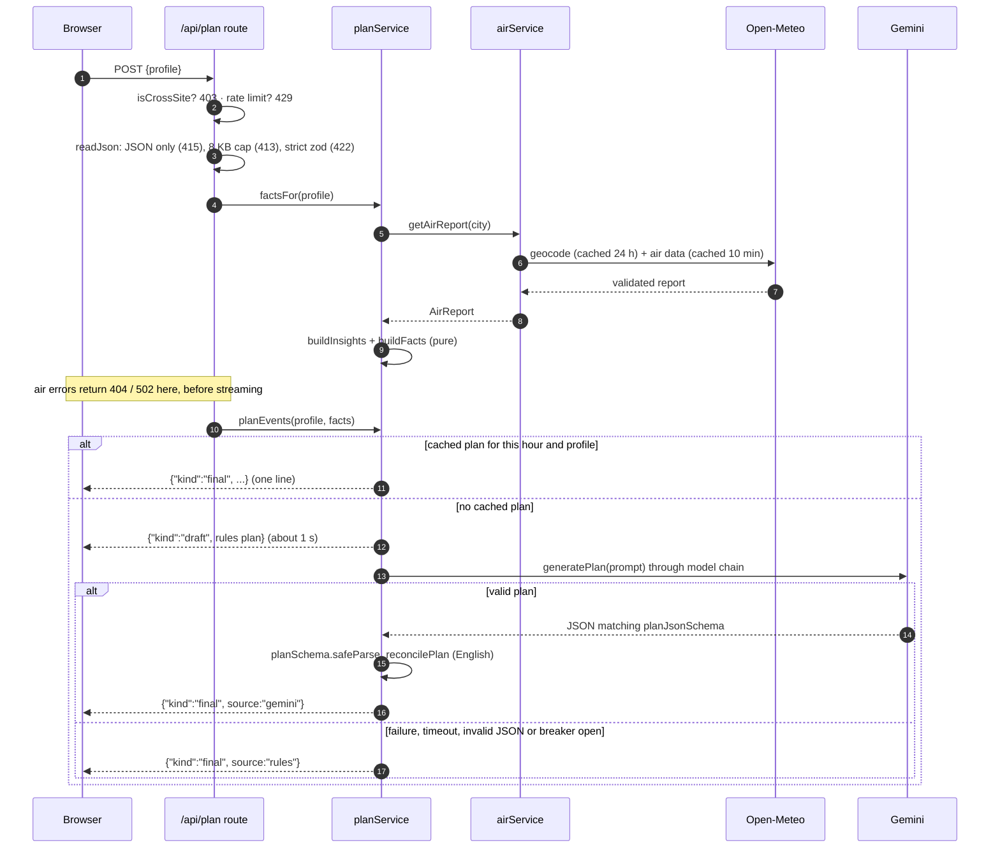

# Architecture

Smog Shield is one Next.js 16 app. Two route handlers (`/api/plan` and `/api/ask`) do all server work. The page is one client component tree. This page explains how the code is split into layers, how a request moves through them, what is cached, and what happens when something fails.

## Layers

Arrows point from the module that is imported to the module that imports it.

| Layer  | Folder                                                                                                                 | Job                                                                                                                            | Does I/O?               |
| ------ | ---------------------------------------------------------------------------------------------------------------------- | ------------------------------------------------------------------------------------------------------------------------------ | ----------------------- |
| Air    | [`src/lib/air`](../src/lib/air)                                                                                        | Geocode a city, fetch and validate Open-Meteo data, AQI bands and the PM2.5 to AQI formula                                     | Yes (`fetch`, injected) |
| Domain | [`src/lib/domain`](../src/lib/domain)                                                                                  | Profile schema, risk, clean/dirty windows, exposure and emission maths, insights, plan schema, rule-based plan, reconciliation | No                      |
| AI     | [`src/lib/ai`](../src/lib/ai)                                                                                          | FACTS block, prompt building, input cleaning, system instructions, model chain, circuit breaker, Gemini client                 | Only `gemini.ts`        |
| Server | [`src/lib/server`](../src/lib/server)                                                                                  | Wiring (`services.ts`), plan and air services, TTL cache, LRU, rate limiter, HTTP helpers, CSP                                 | Through injected deps   |
| Routes | [`src/app/api/plan/route.ts`](../src/app/api/plan/route.ts), [`src/app/api/ask/route.ts`](../src/app/api/ask/route.ts) | Check the request, call the services, stream the response                                                                      | Yes                     |
| Client | [`src/lib/client`](../src/lib/client)                                                                                  | Typed `fetch` helpers, NDJSON line reader, saved profile in `localStorage`                                                     | Yes (browser)           |
| UI     | [`src/components`](../src/components)                                                                                  | Form, air report, forecast, plan, impact simulator, ask panel                                                                  | No                      |
| Proxy  | [`src/proxy.ts`](../src/proxy.ts)                                                                                      | Fresh CSP nonce for every page request                                                                                         | No                      |

### Dependency rules

1. **The domain is pure.** Files in `src/lib/domain` import only other domain files, `src/lib/air/types.ts`, `src/lib/air/aqi.ts`, `src/lib/math.ts` and `zod`. No `fetch`, no environment variables, no clock reads. Every number a user sees is computed here, so it can be tested with plain inputs and outputs.
2. **Server code stays on the server.** [`src/lib/ai/gemini.ts`](../src/lib/ai/gemini.ts) and [`src/lib/server/services.ts`](../src/lib/server/services.ts) start with `import "server-only"`, so the build fails if a client component imports them. The Gemini key is read only in `assistantFromEnv()`.
3. **The client never imports server code.** Components import from `src/lib/domain`, `src/lib/air` (types and AQI bands) and `src/lib/client`. Domain types such as `Plan` and `PlanResult` are imported with `import type`, so no runtime code comes along.
4. **zod is lazy-loaded on the client.** [`src/lib/domain/profile-options.ts`](../src/lib/domain/profile-options.ts) holds labels, limits and defaults with no zod import. The schema itself (`profileSchema` in [`profile.ts`](../src/lib/domain/profile.ts)) is loaded with a dynamic `import()` in [`src/lib/client/profile-storage.ts`](../src/lib/client/profile-storage.ts) only when the form is submitted or a saved profile is read.
5. **One wiring point.** [`src/lib/server/services.ts`](../src/lib/server/services.ts) is the only file that joins real dependencies together. Everything else is a factory (`createAirService`, `createPlanService`, `createAssistant`, `createTtlCache`, `createRateLimiter`, `createCircuitBreaker`) that takes its dependencies as arguments.

## Request lifecycle: `/api/plan`

The response is NDJSON (`application/x-ndjson`): one JSON object per line, each a `PlanEvent` (`{ kind: "draft" | "final", result: PlanResult }`, see [`src/lib/domain/result.ts`](../src/lib/domain/result.ts)).

Steps in code:

Steps 1 to 3 are one call, [`guardRequest`](../src/lib/server/http.ts), shared by both routes.

1. [`isCrossSite`](../src/lib/server/http.ts) refuses requests whose `Sec-Fetch-Site` or `Origin` shows another site (403).
2. `planLimiter.check(clientKey(request))` allows 10 plans a minute per IP (429 with `Retry-After`).
3. [`readJson`](../src/lib/server/http.ts) checks `Content-Type`, rejects a declared `Content-Length` over 8 KB, then reads the stream with [`readCapped`](../src/lib/server/http.ts), which stops at 8 KB. The body is parsed with `z.object({ profile: profileSchema }).strict()`.
4. `planService.factsFor(profile)` gets the air report, runs [`buildInsights`](../src/lib/domain/insights.ts) and writes the FACTS text with [`buildFacts`](../src/lib/ai/facts.ts). Air errors become clean status codes through [`errorResponse`](../src/lib/server/http.ts) before any bytes are streamed.
5. `planService.planEvents()` ([`plan-service.ts`](../src/lib/server/plan-service.ts)) yields a rules draft, waits for Gemini, then yields the final plan.
6. On the client, [`requestPlan`](../src/lib/client/api.ts) splits the stream into lines and calls `onEvent` for each. If the stream ends with no `final` line, it throws "The plan was cut off". [`SmogShieldApp`](../src/components/SmogShieldApp.tsx) shows the draft at once (marked as pending) and swaps in the final plan.

## Request lifecycle: `/api/ask`

1. If there is no API key or the circuit breaker is open, it returns 503 at once with a friendly message, before any other work.
2. `guardRequest`: cross-site check (403), then `askLimiter` with 20 questions a minute per IP (429), then `readJson` with `{ profile, question }` (strict). The question is 3 to 300 characters (`QUESTION_LIMITS`).
3. Facts are **rebuilt on the server** from the profile with `planService.factsFor()`. The client never sends numbers.
4. [`buildAskPrompt`](../src/lib/ai/prompt.ts) wraps the cleaned question in `<question>` tags. `assistant.streamAnswer()` streams Gemini's text, and [`streamText`](../src/lib/server/http.ts) writes each chunk to a `text/plain`, `no-store` response.
5. If the stream breaks part way, `streamText` adds "Sorry, the answer was cut off. Please try again." and closes cleanly. The client's abort signal is passed down, so closing the tab stops the Gemini call.

## Caching

All caches are in memory, per server instance, built on [`createTtlCache`](../src/lib/server/ttl-cache.ts), which stores the **promise** rather than the value. Two requests for the same key at the same moment share one upstream call. Failed loads are removed so the next request retries, unless the cache is told to keep that error.

| Cache                               | Key                                               | TTL                                | Max entries | Defined in                                                   |
| ----------------------------------- | ------------------------------------------------- | ---------------------------------- | ----------- | ------------------------------------------------------------ |
| Geocoding                           | city name, trimmed, spaces collapsed, lower-cased | 24 h (also keeps "city not found") | 2,000       | [`air-service.ts`](../src/lib/server/air-service.ts)         |
| Air report                          | `lat,lon` rounded to 2 decimals                   | 10 min                             | 500         | [`air-service.ts`](../src/lib/server/air-service.ts)         |
| Gemini plan                         | `report.now.time` + full profile JSON             | 1 h                                | 200         | [`plan-service.ts`](../src/lib/server/plan-service.ts)       |
| Rules plan (after a Gemini failure) | same as above                                     | 60 s                               | 200         | [`plan-service.ts`](../src/lib/server/plan-service.ts)       |
| Saved profile                       | `smog-shield:profile` in `localStorage`           | until changed                      | 1           | [`profile-storage.ts`](../src/lib/client/profile-storage.ts) |

Each TTL cache sits on an [`LruCache`](../src/lib/server/lru.ts) (a `Map` in insertion order), so memory stays bounded. The rate limiters keep at most 5,000 keys each and drop expired keys first ([`rate-limit.ts`](../src/lib/server/rate-limit.ts)).

## Failure modes and fallbacks

| What fails                                                 | What the user gets                                                                                                               | Where                                                                                                          |
| ---------------------------------------------------------- | -------------------------------------------------------------------------------------------------------------------------------- | -------------------------------------------------------------------------------------------------------------- |
| No `GEMINI_API_KEY`                                        | Full rules plan; `/api/ask` returns 503 with a clear message                                                                     | `assistantFromEnv()` in [`gemini.ts`](../src/lib/ai/gemini.ts), [`services.ts`](../src/lib/server/services.ts) |
| Default model overloaded (503), rate limited (429) or slow | Next model in `DEFAULT_MODELS` is tried after 300 ms. Each attempt has a 15 s limit inside a 26 s plan budget (25 s for answers) | [`model-chain.ts`](../src/lib/ai/model-chain.ts)                                                               |
| Any other Gemini error (for example 400)                   | The chain stops at once (not retryable); rules plan is kept                                                                      | `isRetryable()` in [`model-chain.ts`](../src/lib/ai/model-chain.ts)                                            |
| 3 Gemini failures in a row                                 | Circuit breaker opens for 60 s. Plans skip Gemini and use rules at once; `/api/ask` returns 503                                  | [`circuit-breaker.ts`](../src/lib/ai/circuit-breaker.ts)                                                       |
| Gemini returns JSON that fails `planSchema`                | Counted as a failure; rules plan is used                                                                                         | `generatePlan()` in [`gemini.ts`](../src/lib/ai/gemini.ts)                                                     |
| Gemini plan is thin (English)                              | Topped up from the rules plan: at least 3 indoor fixes, the top 3 commute swaps, 2 community actions                             | [`reconcile.ts`](../src/lib/domain/rules/reconcile.ts)                                                         |
| Gemini just failed for this key                            | Rules plan cached for 60 s, so repeat requests do not wait again                                                                 | [`plan-service.ts`](../src/lib/server/plan-service.ts)                                                         |
| Open-Meteo drops a connection or returns 5xx               | One retry, 6 s timeout per attempt, then 502 with a clear message                                                                | [`fetch-json.ts`](../src/lib/air/fetch-json.ts)                                                                |
| Open-Meteo returns an odd payload                          | zod check fails, 502 "Air quality data was incomplete"                                                                           | [`open-meteo.ts`](../src/lib/air/open-meteo.ts)                                                                |
| City not found                                             | 404 with "Try the English spelling"; the miss is cached for a day                                                                | [`geocode.ts`](../src/lib/air/geocode.ts), [`air-service.ts`](../src/lib/server/air-service.ts)                |
| Plan stream cut before the final line                      | Client shows "The plan was cut off. Please try again."                                                                           | [`api.ts`](../src/lib/client/api.ts)                                                                           |
| `localStorage` blocked or holds an old shape               | App starts from the default profile                                                                                              | [`profile-storage.ts`](../src/lib/client/profile-storage.ts)                                                   |
| Unknown server error                                       | 500 with a generic message; details go only to the server log                                                                    | `errorResponse()` in [`http.ts`](../src/lib/server/http.ts)                                                    |

## Deployment notes

- Both routes set `preferredRegion = "bom1"` (Mumbai) to sit close to the main users in South Asia.
- `maxDuration` is 40 s for `/api/plan` and 30 s for `/api/ask`, above the 26 s and 25 s model budgets in [`src/lib/ai/budgets.ts`](../src/lib/ai/budgets.ts). Next.js needs `maxDuration` as a literal, so the route tests check that it stays above the budget.
- The page calls `connection()` in [`src/app/page.tsx`](../src/app/page.tsx), so it renders per request and each response gets its own nonce.
